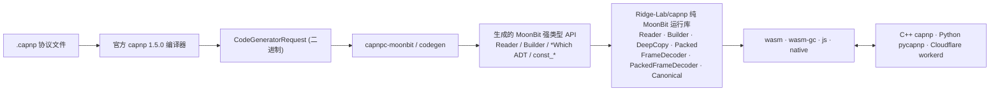

# Cap'n Proto for MoonBit

[](https://github.com/Ridge-Lab/capnp-mbt/actions/workflows/ci.yml)

用同一份 `.capnp` 协议定义，在 MoonBit 与 C++、Python、Cloudflare `workerd` 等生态之间交换二进制数据。本项目提供纯 MoonBit 实现的 **Cap'n Proto 1.5.0 序列化运行库**和 **`capnp` 编译器插件**，从正式的 schema 生成带类型、支持 MoonBit 原生模式匹配的 reader / builder。

适合已有 Cap'n Proto 协议的服务、数据采集程序、离线处理工具和二进制制品检查器接入 MoonBit。协议定义、字段布局和已有数据格式可以继续使用，业务代码无需手写偏移或经 JSON 中转。这里实现的是序列化层；网络传输和 RPC 不在本版本范围内。

**0.6.0 的兼容基准是 Cap'n Proto 1.5.0。** 泛型容器、AnyPointer、常量、强类型联合体 ADT（`<Type>Which` + `which_case()`）以及完整 Canonical 闭环（`canonicalize` / `is_canonical` / 零拷贝 `read_canonical`）均纳入序列化支持，使用未经删改的官方 `test.capnp`、`schema.capnp` 与 Cloudflare `workerd` 真实协议验证。[标准目标](docs/SERIALIZATION-STANDARD.md)与[验证矩阵](docs/CONFORMANCE.md)将兼容承诺对应到测试、独立参考实现和复现步骤。

## 架构概览



## 生态定位与增量

| 项目 | 格式 | 适用场景 |
| --- | --- | --- |
| [moonbitlang/protoc-gen-mbt](https://github.com/moonbitlang/protoc-gen-mbt) | Protocol Buffers | 已有 `.proto` 协议与 gRPC/Protobuf 数据交换 |
| [mizchi/flatbuffers](https://github.com/mizchi/flatbuffers) | FlatBuffers | 已有 `.fbs` 协议与 FlatBuffers 数据读取 |
| **Ridge-Lab/capnp（本项目）** | **Cap'n Proto 1.5.0** | **已有 `.capnp` 协议（含泛型、AnyPointer、packed 流、canonical 校验及 `workerd` 制品检查）** |

例如采集器已有一批按 `.capnp` 定义写出的 packed 消息，或需要直接解析 Cloudflare `workerd` 编译出的二进制部署配置与内置模块包时，MoonBit 可以直接从同一份原始 schema 生成强类型接口，无需改写协议或绑定 C++ 动态库。

## 可运行的完整流程

- **Cloudflare `workerd` 部署配置检查（[`examples/workerd_config`](examples/workerd_config/README.md)）**：从 1,455 行原始 `workerd.capnp` 生成 MoonBit reader，用强类型 `which_case()` 模式匹配列出并提取 `workerd compile --config-only` 生成的二进制配置中的 Worker 源码，再交由 `workerd test --binary` 回读同一份制品运行上游测试。
- **Cloudflare `workerd` 内置模块包读取（[`examples/builtin_bundle`](examples/builtin_bundle/README.md)）**：从官方发行的 `workerd` 二进制中取出 Pyodide `Modules.Bundle`，用 MoonBit 列出全部 28 个内置模块并按名导出。CI 通过独立 `pycapnp` / C++ reader 逐字节核对全部 28 份导出载荷，并核对两个 Python 源文件的上游 Git blob 哈希。
- **跨语言遥测批处理（[`examples/telemetry`](examples/telemetry/README.md)）**：MoonBit 写入含 64 位 ID、纳秒时间戳和 NaN/Missing 读数的消息 → Python (`pycapnp`) 独立统计并写回 `Report` → MoonBit 用 `match report.which_case()` 核对统计结果与超过 JS 安全整数范围的 64 位 ID。
- **未经删改的官方 1.5.0 协议互操作（[`examples/schema_compat`](examples/schema_compat/README.md)）**：两端直接使用官方 `test.capnp` 与 `schema.capnp`，覆盖嵌套泛型、祖先作用域绑定、五种 AnyPointer 负载、常量、旧新版本演进、未知字段透传、嵌套 union 与交错 group。
- **有界增量流处理（[`examples/streaming`](examples/streaming/README.md)）**：[`FrameDecoder`](stream.mbt) 与 [`PackedFrameDecoder`](packed_stream.mbt) 支持普通帧与 packed 压缩流的任意分片读取与边解包边分帧（单次最多读取 8 KiB、展开缓冲上限 2 KiB、单帧与单批输出独立设限），与独立 C++ 端双向流式交换，无需将整条流加载入内存。

## 安装与快速运行

需要 MoonBit **0.10.16 或更新版本**。当前复现工具链及 CI 配置固定为 `0.10.22+124d61d05`（使用相同版本 core），同时在 CI 中保留 `0.10.16+b1a0e846e` 最低版本验证。运行库支持 `wasm`、`wasm-gc`、`js`、`native`，无需 C++ Cap'n Proto 动态库。

在自己的 MoonBit 项目中添加依赖：

```sh
moon add Ridge-Lab/capnp@0.6.0
```

包的 `moon.pkg` 中导入：

```moonbit
import {
  "Ridge-Lab/capnp",
}
```

直接运行本仓库的最小可运行示例（已包含生成代码，无需先安装 `capnp`）：

```sh
git clone --branch v0.6.0 https://github.com/Ridge-Lab/capnp-mbt
cd capnp-mbt
moon update
moon run --target js examples/roundtrip
```

输出包含 `Read job 9007199254740993` 和 6 个样本。Node.js 需支持 ESM；本项目在 Node.js 24 上验证。

## 从 schema 生成 MoonBit API

安装[官方 Cap'n Proto 编译器 1.5.0](https://capnproto.org/install.html)并用 `capnp --version` 确认版本。既可构建 native 插件，也可直接使用请求文件与 Node.js（无需 C 编译器）：

```sh
# 方式一：Node.js + 请求文件（跨平台，无需 C 编译器）
capnp compile -o- fixtures/conformance.capnp > request.bin
moon run --target js cmd/capnpc-moonbit -- --request request.bin --out generated
moon fmt

# 方式二：native 官方插件直连
moon build --target native --release cmd/capnpc-moonbit
capnp compile -o./_build/native/release/build/cmd/capnpc-moonbit/capnpc-moonbit.exe:examples/telemetry/generated examples/telemetry/schema/telemetry.capnp
moon fmt
moon check --target native --deny-warn
```

插件接收官方 `CodeGeneratorRequest`，由官方编译器负责语法解析、import 与字段布局；所有声明生成到同一个 `capnp_generated.mbt`，纯枚举或标量常量 schema 自动省略运行库依赖。二进制重定向请使用 Bash 或 `cmd.exe`；Windows native 构建说明见[开发文档](docs/DEVELOPMENT.md)。

使用生成 API（含 0.6.0 强类型联合体 `which_case()` 与规范段零拷贝读取，完整可运行代码见 [`sample.mbt`](examples/telemetry/sample/sample.mbt)）：

```moonbit
let message = @capnp.Builder::new()
let batch = @telemetry.BatchBuilder::init_root(message)
batch.set_job_id(9007199254740993UL)
batch.set_source("room-temperature")
let samples = batch.init_samples(1)
samples.get(0).set_value(21.5)
samples.get(0).set_quality(@telemetry.Valid)
let bytes = message.finish()

// 1. 标准帧解码
let received = @telemetry.BatchReader::from_message(@capnp.read_message(bytes))
assert_eq(received.get_samples().get(0).get_value(), 21.5)

// 2. Canonical 规范化、严格校验与零拷贝读取（无 segment table）
let canonical = @capnp.canonicalize(@capnp.read_message(bytes))
assert_true(@capnp.is_canonical(canonical))
let from_canonical = @telemetry.BatchReader::from_message(@capnp.read_canonical(canonical))
assert_eq(from_canonical.get_job_id(), 9007199254740993UL)

// 3. 强类型联合体 ADT 模式匹配（保留向前兼容 Unknown(tag) 分支）
match report.which_case() {
  Statistics(stats) => println("mean=\{stats.get_mean()}")
  Empty => println("no valid samples")
  Unknown(tag) => println("unknown union tag: \{tag}")
}
```

reader 返回字段视图，实际访问指针时验证目标范围；Text 转换执行 UTF-8 验证。低层运行库接口见 [`pkg.generated.mbti`](pkg.generated.mbti)。

## 功能与边界

| 能力 | 当前范围 |
| --- | --- |
| 数据类型 | Void、Bool、所有整数和浮点宽度、Text、Data、enum、struct、嵌套声明 |
| 容器与联合体 | primitive / pointer / inline-composite list、嵌套 list、group、union（提供原生 `<Type>Which` ADT 与 `which_case()` 及兼容 `which()`）、标量与复合默认值 |
| 泛型与常量 | 显式及祖先作用域绑定、嵌套泛型、别名、未绑定参数；标量、列表、结构体及泛型常量 |
| 动态负载 | AnyPointer / AnyStruct / AnyList 视图与写入；保留未知字段的深拷贝，失败时回滚目标 |
| 帧和指针 | 标准分段帧、近指针、单跳和双跳 far pointer 的读取；writer 生成单段帧 |
| 压缩与流 | 标准 packed 编解码；`FrameDecoder` / `PackedFrameDecoder` 分别增量处理普通 / packed 帧，支持任意碎片输入、串联帧及 EOF 校验 |
| Canonical 闭环 | `canonicalize` 生成规范单段；`is_canonical` 严格校验规范约束；`read_canonical` 校验并返回零拷贝 `Message` |
| 防护 | 指针越界检查、共享遍历预算、嵌套深度限制、段数限制、解包和 writer 分配上限、非规范篡改拒绝 |
| 演进 | 缺失字段默认值、额外字段跳过、未知 enum 值与未知 union tag 保留、兼容的 list / struct 扩展 |
| 范围外 | RPC 客户端/服务器、活动 capability table、builder 原位编辑收到的消息 |

已知泛型绑定生成具体类型；未绑定参数和递归增长的泛型边界保留动态视图，业务代码可通过公开的 `.inner` 继续访问，无需改写 schema。接口声明不会阻止同文件中的数据类型生成，但不生成 RPC 调用代码。合法 schema 与自动生成的 `Reader`/`Builder`/`Which`/列表包装器或字段名冲突时，生成器使用稳定后缀消歧。

默认 reader 遍历预算为 8,388,608 words，嵌套深度 64，最多 512 段；`unpack` 默认最多输出 64 MiB。处理分块流时，标准未压缩帧使用 `FrameDecoder`，packed 压缩流使用 `PackedFrameDecoder`，结束时均需调用 `finish()` 检查截断，错误后需 `reset()`。详见[兼容性和资源限制](docs/COMPATIBILITY.md)与[设计说明](docs/DESIGN.md)。

## 验证闭环与回归成效

开发与 CI 共用统一驱动入口 `scripts/verify.py`，每次运行产出独立日志、前后源码 SHA-256 指纹、工具链记录与 `summary.sha256`；缺失工具、超时、缺失制品或旧报告均判定失败（由 [`verify_harness_test.py`](scripts/verify_harness_test.py) 反向验证失败契约）：

```sh
# 快速验证（无需 capnp / pycapnp）
python scripts/verify.py --profile quick --targets js wasm wasm-gc

# 或直接调用 MoonBit 工具链
moon fmt --check
moon check --target all --deny-warn
moon test --target all --deny-warn
moon build --target all --release

# 完整跨语言外部对照（需官方 capnp 1.5.0 与 pycapnp 2.2.1）
python scripts/verify.py --profile full --targets js native --workerd workerd

# 发布包全新消费者验证（安装 Mooncakes 线上包并测试四后端、CLI 与上游哈希）
python scripts/verify_release.py --release-tag v0.6.0
```

这套“官方编译器对照 + 跨语言 peer + 失败契约 + 模糊变异”验证闭环在迭代中实际拦截并修复了多类隐蔽缺陷：
- **Packed 末尾稠密段提前吐帧（`0.4.2`）**：官方 `capnp encode --packed` 对照测试暴露了末尾 dense run 缺少 run-count 字节时提前释放帧的问题，改为等待完整 token 后原子提交。
- **MoonBit 保留类型名与声明冲突（`0.2.1` / `0.4.2`）**：真实外部 schema 与生成符号冲突（如 `Int32`、`BytesView`、`*Reader`、`*Which`），由全量符号分配器与确定性后缀消歧彻底解决。
- **内联复合列表缺失段误读（`0.2.1`）**：对照 C++ `pycapnp` 发现将纯指针 struct list 误当标量列表读取的边界问题，补齐段存在性校验并保留合法默认值演进。
- **超长 Unicode 文本常量触发源码行长限制（`0.2.2`）**：官方 `embed` 夹具复现后改为按字符边界分块拼接。
- **`moonc 0.10.22` 严格编译回归（`0.6.0`）**：升级至 `0.10.22+124d61d05` 时 `--deny-warn` 捕获 `UInt64::extend_uint` 弃用告警，迁移为 `UInt::to_uint64()` 并保持 `0.10.16` 兼容。

目前包含 **103 个 MoonBit 单元测试**（含 1,024 组深拷贝变异与 256 组 packed 差分模糊用例）、**12 份官方 1.5.0 schema 零漂移再生对照**、**11 组官方 canonical 向量双向校验**与 **4 后端 + Windows native + Linux 跨语言 CI**。[基础样例](fixtures/README.md)、[原样上游协议](fixtures/upstream/capnproto-1.5.0/README.md)、[workerd 上游协议](fixtures/upstream/workerd/README.md)与[官方 oracle 数据](fixtures/upstream/oracle-1.5.0/README.md)均附来源与 SHA-256 清单。

## 性能基准（可复现）

[基准脚本](benchmarks/README.md)在进程内测量 8 类运行库核心操作（含预热、自动校准、校验和、环境与源码哈希）。以下为 `0.6.0` 在 Windows x86-64 / `moonc 0.10.22+124d61d05` / Node.js 24.14.1 下的本地实测中位数（原始 5 轮数据见 [`local-windows-js-0.6.0.json`](benchmarks/results/local-windows-js-0.6.0.json)；历史 `0.3.0` native/JS 对照见 [`benchmarks/results/README.md`](benchmarks/results/README.md)）：

| 操作 | 1 样本 (112 B) | 32 样本 (856 B) | 512 样本 (12,376 B) | 说明 |
| --- | ---: | ---: | ---: | --- |
| `selected_read` | 1.05 µs | 1.02 µs | 1.02 µs | 仅读关键字段，随消息扩大 110× 仍保持 $O(1)$ 随机访问 |
| `full_scan` | 2.02 µs | 14.14 µs | 190.64 µs | 遍历全部字段、UTF-8 解码与全部样本 |
| `encode` | 5.36 µs | 34.37 µs | 388.62 µs | 构建完整消息并输出标准帧 |
| `pack` / `unpack` | 0.97 / 1.84 µs | 9.75 / 8.57 µs | 97.54 / 125.16 µs | 标准 Cap'n Proto packed 编解码 |
| `opaque_copy` | 5.94 µs | 14.56 µs | 169.52 µs | 未知 schema 下的递归深拷贝与规范校验 |
| `framed_stream` / `packed_stream` | 2.12 / 3.81 µs | 8.14 / 18.92 µs | 133.67 / 256.90 µs | 1 KiB 分块增量分帧（普通 / packed） |

注：基准包含分配、GC 与校验和开销，仅用于同机复现与回归观察，不代表生产负载或跨语言绝对排名。

## 来源与许可证

MIT（见 [`LICENSE`](LICENSE)）。运行库按[公开编码规范](https://capnproto.org/encoding.html)独立实现；生成器接入[官方插件协议](https://capnproto.org/otherlang.html)。不是 C++ 库的 FFI 包装，也未使用 MoonBit SWE-AGI 中的 Cap'n Proto 解码题解。

第三方依赖、上游夹具（Cap'n Proto 1.5.0 MIT、Cloudflare `workerd` Apache-2.0）及生成文件的完整来源、许可证与 SHA-256 校验见 [`docs/PROVENANCE.md`](docs/PROVENANCE.md)。
